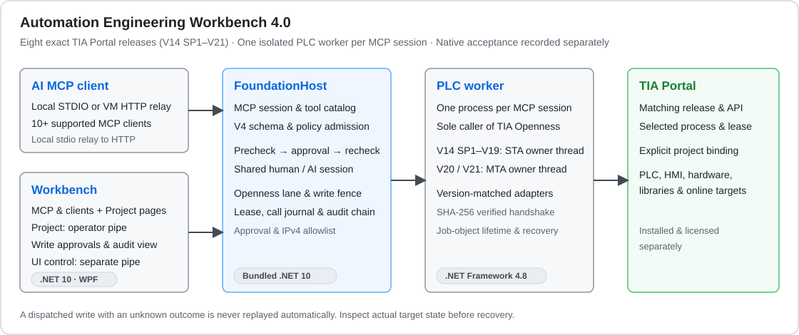

#  Automation Engineering Workbench for TIA Portal

[中文](README.zh-CN.md) · [Beginner guide (Chinese)](docs/getting-started/beginners.zh-CN.md) · [Documentation](docs/README.md) · [Downloads](https://github.com/asckye/automation-engineering-workbench/releases)

An MCP server and Windows desktop Workbench for Siemens TIA Portal Openness across eight exact releases: **V14 SP1, V15.1, and V16–V21**. Connect AI coding agents or work directly in the Workbench to browse projects, author PLC/HMI artifacts, compile, test, and diagnose—backed by preview-first write approvals, hash-chained audit logs, and isolated per-session Openness workers.

> [!NOTE]
> **Name and release status:** Formerly **TIA Portal Openness MCP**. Executables (`TiaOpenness.exe`), the Claude Code plugin ID `tia-portal-openness-mcp`, and the MCP server name `tia-portal` keep their original names so existing configurations continue to work. GitHub redirects old repository links. This page documents the unreleased 4.0 source (current pre-release: [v4.0.0-rc.8](docs/releases/v4.0.0-rc.8.md)); GitHub **Latest** remains stable 3.3. For a downloaded release, use the documentation bundled inside its archive.



## Why this workbench

- **Eight exact TIA Portal releases, one architecture:** A unified .NET 10 `FoundationHost` launches one isolated .NET Framework 4.8 `PLC worker` per MCP session with an adapter compiled against that release's official Openness SDK.
- **Human-in-the-loop safety by default:** Write and online-write calls run a read-only preview precheck before queueing for approval in the Workbench, recheck inputs before dispatch, and record decisions in a hash-chained audit log (`data/logs/audit`). Online writes add explicit IPv4 allowlists and mandatory confirmation for physical PLC targets.
- **Shared AI and engineer window:** One bilingual (English / Chinese) Workbench window houses **MCP & clients** and **Project** pages. Engineers attach to the active MCP session with the same tools, approvals, and audit trail—or open a Workbench-owned session without an AI client.
- **Ready for local and VM ↔ host setups:** Built-in configuration cards write and back up configs for Claude Code, Codex, Gemini CLI, Cursor, VS Code Copilot, OpenCode (DeepSeek / GLM / Grok), Qwen, Kimi, and Yuanbao. VM deployments use a local stdio relay to reach the key-free HTTP endpoint. Use it only on a trusted LAN or a host-only VM network. Any device that can reach the endpoint can call tools.
- **Broad engineering and offline tooling:** Covers PLC blocks (SCL/LAD/DB/UDT/software units), watch and force tables, Classic HMI and WinCC Unified, hardware and subnets, libraries, PLC test scenarios with JUnit and FAT/SAT reports, SimaticML visual diff, static ladder rendering, and Git workflows.

## Get started

> [!IMPORTANT]
> Download the delivery ZIP and its `.sha256` sidecar from [Releases](https://github.com/asckye/automation-engineering-workbench/releases), then extract the entire archive to a short, permanent directory. For a 4.0 beta or rc, select the entry marked **Pre-release**. The 4.0.0 final ZIP will appear under **Latest** as `TIA_MCP_v4.0.0_<date>.zip`. GitHub's `Source code` archives contain no runtime binaries. Because executables are unsigned, Windows SmartScreen may warn on first launch.

4.0 packages omit Siemens TIA Portal assemblies and load Openness from your own TIA installation. Existing 3.x release assets stay as published.

The delivery package bundles runtime binaries, user documentation, templates, the Claude Code plugin, and ecosystem resources. Development sources, build scripts, and validation tools stay in this repository.

1. **Connect an AI client:** Open `TiaOpenness.exe`, go to **MCP & clients**, select your installed TIA Portal release, and choose **Same computer** or **VM ↔ host**. Select your MCP client, write its configuration, restart the client, and start a new conversation. See the [configuration guide](docs/getting-started/configuration.md) or [Claude Code plugin guide](docs/getting-started/plugin.md).
2. **Work directly on a project:** In the same `TiaOpenness.exe`, switch to **Project**, select the TIA release before connecting, bind your project and target PLC, and run browse, export/import, compile, and save operations through the shared session.
3. **Try a mock walkthrough without TIA Portal:** Run `TiaOpenness.exe --mock --lang en` from the extracted bundle root. Results are synthetic.

New to the workbench? Follow the [beginner guide (Chinese)](docs/getting-started/beginners.zh-CN.md) for installation, VM file-path rules, PLC selection, and a first SCL import/compile exercise.

Upgrading from 3.3? Install 4.0 side by side—the 3.3 updater does not offer 4.0 yet—following the [3.3 to 4.0 migration guide (Chinese)](docs/guides/migrate-3.3-to-4.0.md). Testing a pre-release on a real TIA Portal? Record results with the [beta tester checklist (Chinese)](docs/guides/beta-tester-checklist.md).

## Supported releases and tool catalog

<!-- generated:tool-counts:begin -->
Generated by `generate-tool-counts` from `manifest/version-tools.json` and `ToolProfiles.resx`. Runtime `tools/list` is authoritative.

| TIA release | Registered tools | Lite profile |
|---|---:|---:|
| V14 SP1 | 287 | 93 |
| V15.1 | 328 | 96 |
| V16 | 354 | 96 |
| V17 | 377 | 96 |
| V18 | 402 | 98 |
| V19 | 478 | 98 |
| V20 | 499 | 101 |
| V21 | 518 | 104 |
<!-- generated:tool-counts:end -->

<!-- generated:real-machine-status:begin -->
### Real-machine records cover 3205 of 3243 registered tool and release pairs

| TIA release | Registered | Calling the Siemens API | With records | All succeeded | With failures | Last candidate | Run date (UTC) |
|---|---:|---:|---:|---:|---:|---|---|
| V14 SP1 | 287 | 191 | 286 | 147 | 71 | d89d0152 | 2026-11-19 |
| V15.1 | 328 | 232 | 309 | 177 | 66 | d89d0152 | 2026-11-19 |
| V16 | 354 | 258 | 349 | 186 | 83 | d89d0152 | 2026-11-19 |
| V17 | 377 | 280 | 374 | 198 | 69 | 9a4274f2 | 2026-11-20 |
| V18 | 402 | 304 | 398 | 217 | 82 | d89d0152 | 2026-11-20 |
| V19 | 478 | 372 | 476 | 284 | 68 | d89d0152 | 2026-11-20 |
| V20 | 499 | 383 | 497 | 287 | 91 | d89d0152 | 2026-11-20 |
| V21 | 518 | 396 | 516 | 291 | 117 | 02107734 | 2026-11-19 |

Some cells use records from an older candidate, marked ᵒ in the full table.

[View the records for each tool](docs/reference/real-machine-status.md)
<!-- generated:real-machine-status:end -->

- **Profiles and on-demand discovery:** All eight releases default to the lite profile to keep client context compact; use `FindTools` and `CallTool` for the full catalog, or pass `--profile full`. Call `GetToolUsage(toolName, operation)` before unfamiliar operations to fetch release-matched arguments, complete programming examples (`language` / `exampleId`), and result guidance. Official Siemens API patterns and project-authored wrappers are labeled separately.
- **Unified host and worker layout:** The root launcher is `TiaOpenness.exe`, and every release uses `runtime/v<key>/TiaMcp.FoundationHost.exe --release-key <key>`. Each host starts the matching `PLC worker` under `worker/` (including the full V20/V21 catalog), while shared Foundation tools expose the same contracts across releases. Original V14 and V15 are not aliases for V14 SP1 and V15.1. See [version scope](docs/reference/version-tools.md) and the connected server's `tools/list`.
- **Contracts, safety, and recovery:** The V4 response envelope uses `ok`, `data`, `error`, and `meta`. A dispatched write with an unknown outcome (`OUTCOME_UNKNOWN`) is never replayed automatically; inspect target state before retrying. See [ecosystem tools](docs/reference/ecosystem-tools.md) and the [security model](https://github.com/asckye/automation-engineering-workbench/blob/master/docs/standards/security.md).

## Requirements and validation boundary

- **Prerequisites:** Install the matching Siemens TIA Portal release, Openness, and licenses separately, and add your Windows account to the `Siemens TIA Openness` group. The .NET 10 runtime for the Workbench and `FoundationHost` is bundled in `runtime/dotnet`; the Openness bridge and PLC workers use .NET Framework 4.8 (included in Windows 10 1903 and later). See [runtime paths](https://github.com/asckye/automation-engineering-workbench/blob/master/docs/standards/design.md#3-运行时布局).
- **Acceptance transparency:** All eight runtimes and the Workbench build locally against the official SDKs, and functional, protocol, API metadata, and XML schema checks are recorded separately from real-project acceptance. New native TIA/project acceptance remains **NOT RUN** across releases unless explicitly noted; a tool catalog or clean build does not guarantee every engineering action on every CPU or patch level. Review current limits in [capabilities](docs/reference/capabilities.md).

## Development

`master` is the maintained branch, and runtime binaries are distributed as release assets rather than tracked Git files. From a clean checkout with the documented SDK layout and pinned companion Python environment, build and package all eight releases using the version in `Version.props` (currently `4.0.0-rc.8`):

```powershell
dotnet run --project build-tools/release -- prepare -Version 4.0.0-rc.8 -BuildOnly -PublicApiRoot <SDK-root> -Python <python.exe>
```

`-BuildOnly` compiles and packages all eight versions without running the full validation gates or creating a publishable candidate.

[Build and validation](https://github.com/asckye/automation-engineering-workbench/blob/master/docs/manuals/validation.md) · [Release workflow](https://github.com/asckye/automation-engineering-workbench/blob/master/docs/manuals/release.md) · [Development progress](https://github.com/asckye/automation-engineering-workbench/blob/master/docs/plan/progress.md) · [Changelog](CHANGELOG.md) · [Third-party notices](docs/licenses/THIRD-PARTY-NOTICES.md)

## Origin, license and trademarks

Automation Engineering Workbench was originally derived from the MIT-licensed [bulaofen0036-coder/TIA_Portal_Openness_MCP](https://github.com/bulaofen0036-coder/TIA_Portal_Openness_MCP) and is now developed independently by asckye. The original copyright notice is retained in [LICENSE](LICENSE); provenance details are in [NOTICE](NOTICE.md).

TIA Portal, SIMATIC, STEP 7, WinCC, and Openness are trademarks of Siemens AG; this project is not affiliated with or endorsed by Siemens.
