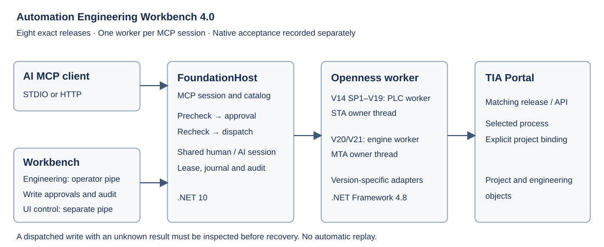

# TIA Portal Openness MCP

[Chinese](README.zh-CN.md) · [Beginner guide (Chinese)](docs/getting-started/beginners.zh-CN.md) · [Documentation](docs/README.md) · [Downloads](https://github.com/asckye/TIA_Portal_Openness_MCP/releases/latest)

One TIA Portal Workbench window contains **MCP & clients** and **Engineering** pages. Configure clients, manage the MCP service and work directly with TIA projects without opening a second desktop application. Chinese and English are supported.

The Workbench is included in the delivery package. This page describes the unreleased 4.0 source; use the documentation included with your downloaded release.



## Get started

Download the complete **TIA_MCP_Delivery** ZIP from Releases and extract the entire archive to a short, permanent directory. GitHub's source archives contain no runtime binaries.

The delivery package contains runtime files, user documentation, templates, the Claude Code plugin and ecosystem resources. Development sources, build scripts and validation tools remain in the source repository.

- **AI client:** open `TiaOpenness.exe`, choose **MCP & clients**, select the installed TIA release and choose Same computer or VM ↔ host. Select the actual MCP client, write its configuration, restart it and start a new conversation. Follow the [configuration guide](docs/getting-started/configuration.md).
- **Engineering:** open the same `TiaOpenness.exe`, switch to **Engineering**, select the TIA release before connecting, select the intended PLC and use browse, export/import, compile and save. The Engineering page attaches to the MCP session and uses the same tools, approvals and audit records. Without an AI session, it can create a Workbench-owned host session.
- **Workbench demonstration:** run `TiaOpenness.exe --mock --lang en` from the extracted package. Results are synthetic.

The [beginner guide](docs/getting-started/beginners.zh-CN.md) explains installation, VM paths, PLC selection and a first SCL import/compile exercise.

## Supported releases

<!-- generated:tool-counts:begin -->
Generated by `generate-tool-counts` from `manifest/version-tools.json` and `ToolProfiles.resx`. Runtime `tools/list` is authoritative.

| TIA release | Registered tools | Lite profile |
|---|---:|---:|
| V14 SP1 | 248 | Not applicable |
| V15.1 | 277 | Not applicable |
| V16 | 299 | Not applicable |
| V17 | 311 | Not applicable |
| V18 | 325 | Not applicable |
| V19 | 360 | Not applicable |
| V20 | 503 | 84 |
| V21 | 516 | 84 |
<!-- generated:tool-counts:end -->

V20/V21 use the lite profile by default; use `FindTools` and `CallTool` for the rest, or configure `--profile full`. The bundle uses `TiaOpenness.exe` as its root launcher and `runtime/v<key>/TiaMcp.FoundationHost.exe --release-key <key>` for every release. V20/V21 retain the full catalog through their engine worker and generated catalog in `worker/`; the shared Foundation tools use the same contracts across releases. Read [version scope](docs/reference/version-tools.md) and the connected server's `tools/list`. Original V14/V15 are not aliases for V14 SP1/V15.1. The V4 envelope uses `ok`, `data`, `error` and `meta`; unknown write outcomes require inspection before any retry. Workbench approval applies to MCP write calls by default, and audit records are kept in `data/logs/audit`.

Before an unfamiliar operation, `GetToolUsage(toolName, operation)` supplies the current release's arguments, examples and result interpretation. Use `language` to list programming examples and `exampleId` to retrieve complete files or call sequences. Official API patterns and project-authored wrappers are identified separately.

## Installation and validation

Install the matching TIA Portal, Openness and licenses separately. The .NET 10 runtime for the unified desktop and the foundation hosts ships in `runtime/dotnet`. The Openness bridge, workers and engine workers require .NET Framework 4.8, which is part of Windows 10 1903 and later. See [runtime paths](runtime/README.md).

All eight runtimes and Studio are built locally against the supplied SDKs. Functional, protocol, API metadata and XML interface checks are recorded separately from real-project acceptance. New native TIA/project acceptance remains **NOT RUN**; a tool catalog or successful build does not establish every engineering operation. Current limits are in [capabilities](docs/reference/capabilities.md).

## Development

`master` is the maintained branch. Runtime binaries are release assets, not tracked Git files. With the documented SDK layout and companion Python environment:

```powershell
dotnet run --project build-tools/release -- build-multi-version -PublicApiRoot <SDK-root> -Python <python.exe> -Test
```

[Build and validation](https://github.com/asckye/TIA_Portal_Openness_MCP/blob/master/docs/development/validation.md) · [Release workflow](https://github.com/asckye/TIA_Portal_Openness_MCP/blob/master/docs/development/release-workflow.md) · [Current handoff](https://github.com/asckye/TIA_Portal_Openness_MCP/blob/master/docs/development/handoff.md) · [Changelog](CHANGELOG.md) · [License notices](docs/licenses/THIRD-PARTY-NOTICES.md)
