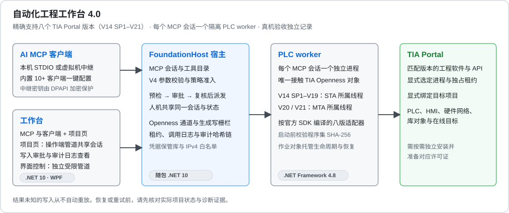

# 自动化工程工作台

[English](README.md) · [新手使用指南](docs/getting-started/beginners.zh-CN.md) · [文档目录](docs/README.md) · [下载交付包](https://github.com/asckye/TIA_Portal_Openness_MCP/releases)

面向 Siemens TIA Portal Openness 的 MCP 服务器与 Windows 桌面工作台，精确支持 **V14 SP1、V15.1 及 V16–V21** 八个版本。既可接入各类 AI 编程客户端，也可在工作台内直接操作项目，提供浏览、PLC/HMI 生成与导入导出、编译、测试与诊断，并默认由“预览预检、工作台人工审批、审计哈希链与会话隔离 worker”保护工程安全。

> [!NOTE]
> **名称与版本说明**：原名 **TIA Portal Openness MCP**。可执行文件 `TiaOpenness.exe`、Claude Code 插件 ID `tia-portal-openness-mcp`、MCP 服务名 `tia-portal` 和仓库地址保持不变，现有配置无需修改。本页说明尚未正式发布的 4.0 源码（当前预发布：[v4.0.0-beta.6](docs/releases/v4.0.0-beta.6.md)），GitHub 的 **Latest** 仍为稳定版 3.3；已下载版本以包内文档为准。



## 核心能力

- **八版统一架构**：统一的 .NET 10 FoundationHost 宿主为每个 MCP 会话启动独立的 .NET Framework 4.8 PLC worker，加载按对应版本官方 Openness SDK 编译的适配器，避免跨版本混用与对象泄漏。
- **默认人工审批与工控安全护栏**：所有写操作与在线写操作默认先运行只读预览预检，再进入工作台人工审批，批准后复核再派发，并写入 `data/logs/audit` 哈希链。在线写支持显式 IPv4 白名单及真实 PLC 下载强确认。
- **人机共享同一窗口**：单一中英双语工作台窗口提供 **MCP 与客户端** 和 **项目** 页面。工程师可直接附着 AI 正在使用的 MCP 会话，共用同一套工具、审批和审计；没有 AI 会话时也可创建工作台自有宿主会话。
- **本机与虚拟机开箱即用**：内置客户端配置卡片，一键写入并备份 Claude Code、Codex、Gemini CLI、Cursor、VS Code Copilot、OpenCode (DeepSeek / GLM / Grok)、Qwen、Kimi、Yuanbao 等客户端配置。虚拟机 ↔ 宿主机模式经本机 stdio 中继连接免密钥 HTTP 端点。可访问端点的设备都能调用工具，仅在可信局域网或虚拟机的仅主机网络中使用。
- **覆盖工程全链路与离线分析**：支持 PLC 程序块（SCL、LAD、DB、UDT 与软件单元）、监控表与强制表、经典 HMI 与 WinCC Unified、硬件与子网、库对象、PLC 测试库与 JUnit / FAT / SAT 报告、SimaticML 离线解码与可视化差异、静态梯形图渲染及 Git 工作流。

## 快速开始

> [!IMPORTANT]
> 从 [Releases](https://github.com/asckye/TIA_Portal_Openness_MCP/releases) 下载完整的 **TIA_MCP_Delivery** ZIP 及其 `.sha256` 校验文件，完整解压到较短的固定目录。GitHub 的 `Source code` 压缩包不含运行二进制。试用 4.0 请选择标有 **Pre-release** 的条目（预发布不会出现在 Latest 中）。可执行文件尚未签名，首次运行时 Windows SmartScreen 可能提示警告。

交付包包含运行文件、用户文档、模板、Claude Code 插件和生态资源；开发源码、构建脚本与验证工具保留在源码仓库。

1. **接入 AI 客户端**：双击包根 `TiaOpenness.exe`，在 **MCP 与客户端** 页选择实际安装的 TIA Portal 版本和 **同一台电脑** 或 **虚拟机 ↔ 宿主机**，选择客户端卡片写入配置，重启客户端并新建会话。详情见[配置指南](docs/getting-started/configuration.md)和 [Claude Code 插件安装](docs/getting-started/plugin.md)。
2. **工程师直接操作项目**：在同一个 `TiaOpenness.exe` 中切换到 **项目** 页，连接前选择顶部 TIA 版本，绑定项目与目标 PLC，即可经共享会话执行浏览、导入导出、编译和保存。
3. **无 TIA 环境先看演示**：在解压后的包根目录运行 `TiaOpenness.exe --mock --lang zh`，使用模拟数据体验界面。

第一次使用建议按[新手使用指南](docs/getting-started/beginners.zh-CN.md)完成安装、虚拟机路径核对、PLC 选择和首个 SCL 导入编译练习。

已在使用 3.3 的用户请参考[从 3.3 迁移到 4.0](docs/guides/migrate-3.3-to-4.0.md)并排安装（3.3 更新器暂不推送 4.0）。在真实 TIA Portal 上测试预发布版本时，请按[预发布真机验证清单](docs/guides/beta-tester-checklist.md)记录并反馈。

## 支持版本与工具目录

<!-- generated:tool-counts:begin -->
由 `generate-tool-counts` 从 `manifest/version-tools.json` 和 `ToolProfiles.resx` 生成。以运行时 `tools/list` 为准。

| TIA 版本 | 注册工具数 | lite 档 |
|---|---:|---:|
| V14 SP1 | 287 | 93 |
| V15.1 | 328 | 96 |
| V16 | 354 | 96 |
| V17 | 377 | 96 |
| V18 | 403 | 98 |
| V19 | 479 | 98 |
| V20 | 500 | 101 |
| V21 | 519 | 104 |
<!-- generated:tool-counts:end -->

<!-- generated:real-machine-status:begin -->
### 真机记录覆盖 3209/3247 个已注册的工具与版本组合

| TIA 版本 | 注册工具 | 调用西门子 API | 有实机记录 | 全部成功 | 有失败 | 最近候选提交 | 运行日期（UTC） |
|---|---:|---:|---:|---:|---:|---|---|
| V14 SP1 | 287 | 191 | 286 | 147 | 71 | d89d0152 | 2026-11-19 |
| V15.1 | 328 | 232 | 309 | 177 | 66 | d89d0152 | 2026-11-19 |
| V16 | 354 | 258 | 349 | 186 | 83 | d89d0152 | 2026-11-19 |
| V17 | 377 | 280 | 374 | 198 | 69 | 9a4274f2 | 2026-11-20 |
| V18 | 403 | 305 | 399 | 217 | 83 | d89d0152 | 2026-11-20 |
| V19 | 479 | 373 | 477 | 284 | 68 | d89d0152 | 2026-11-20 |
| V20 | 500 | 384 | 498 | 287 | 91 | d89d0152 | 2026-11-20 |
| V21 | 519 | 397 | 517 | 291 | 117 | 02107734 | 2026-11-19 |

部分记录来自较早的候选版本，在完整表中以 ᵒ 标出。

[查看每个工具的真机记录](docs/reference/real-machine-status.md)
<!-- generated:real-machine-status:end -->

- **按需发现与统一示例入口**：八个版本默认使用 lite 档以节省上下文；其余工具通过 `FindTools` 查找、`CallTool` 调用，也可配置 `--profile full`。调用不熟悉的工具前，使用 `GetToolUsage(toolName, operation)` 获取当前版本的参数、完整编程示例 (`language` / `exampleId`) 和结果解释；官方 API 模式与本项目封装示例分别标明。
- **统一入口与隔离 worker**：交付包根入口为 `TiaOpenness.exe`，八版宿主统一入口为 `runtime/v<发布键>/TiaMcp.FoundationHost.exe --release-key <发布键>`。宿主自动启动 `worker/` 下对应版本的 PLC worker（V20/V21 完整工具目录也由该 worker 执行），八版共有工具使用同一份 Foundation 契约。V14 SP1、V15.1 不等于原版 V14、V15。详细范围见[逐版本工具说明](docs/reference/version-tools.md)和实际服务的 `tools/list`。
- **契约、容错与安全**：V4 响应信封包含 `ok`、`data`、`error` 和 `meta`。结果未知的写入 (`OUTCOME_UNKNOWN`) 从不自动重放，重试前须先核对目标状态。更多内容见[已接入生态工具](docs/reference/ecosystem-tools.md)和[安全标准与威胁模型](https://github.com/asckye/TIA_Portal_Openness_MCP/blob/master/docs/standards/security.md)。

## 环境要求与验收边界

- **运行环境**：按需独立安装对应版本的 TIA Portal、Openness 及许可证，并将当前 Windows 用户加入 `Siemens TIA Openness` 用户组。工作台与宿主所需的 .NET 10 运行时已随包附带 (`runtime/dotnet`)；Openness 桥接进程和 PLC worker 需要 .NET Framework 4.8（Windows 10 1903 及以后已自带）。目录结构见[运行时布局](https://github.com/asckye/TIA_Portal_Openness_MCP/blob/master/docs/standards/design.md#3-运行时布局)。
- **验证边界**：八版本运行文件、工作台、协议、离线功能及官方 SDK / XSD 检查均独立记录于真机验收之外；新增功能的真实 TIA 项目验收仍为 **NOT RUN**。工具目录存在或构建通过不代表所有设备、补丁和选件均已通过真实项目验证，当前范围与限制见[能力与验收说明](docs/reference/capabilities.md)。

## 开发和维护

仅维护 `master`，运行二进制随 Release 分发，不提交到 Git。准备好文档规定的 SDK 目录和固定版本的伴随 Python 环境后，在干净 checkout 的根目录运行以下命令（版本号须与 `Version.props` 一致，当前为 `4.0.0-beta.6`）：

```powershell
dotnet run --project build-tools/release -- prepare -Version 4.0.0-beta.6 -BuildOnly -PublicApiRoot <SDK-root> -Python <python.exe>
```

`-BuildOnly` 仅构建并打包八个版本，不运行完整检查门禁，也不生成可发布候选。

[构建与验证](https://github.com/asckye/TIA_Portal_Openness_MCP/blob/master/docs/manuals/validation.md) · [发布流程](https://github.com/asckye/TIA_Portal_Openness_MCP/blob/master/docs/manuals/release.md) · [开发进度](https://github.com/asckye/TIA_Portal_Openness_MCP/blob/master/docs/plan/progress.md) · [变更记录](CHANGELOG.md) · [第三方许可证](docs/licenses/THIRD-PARTY-NOTICES.md)

## 来源、许可证和商标

自动化工程工作台最初派生自 MIT 许可的 [bulaofen0036-coder/TIA_Portal_Openness_MCP](https://github.com/bulaofen0036-coder/TIA_Portal_Openness_MCP)，现由 asckye 独立开发。原始版权声明保留在 [LICENSE](LICENSE)，来源说明见 [NOTICE](NOTICE.md)。

TIA Portal、SIMATIC、STEP 7、WinCC 和 Openness 是 Siemens AG 的商标；本项目与 Siemens 无关联，也未获得 Siemens 的认可或背书。
