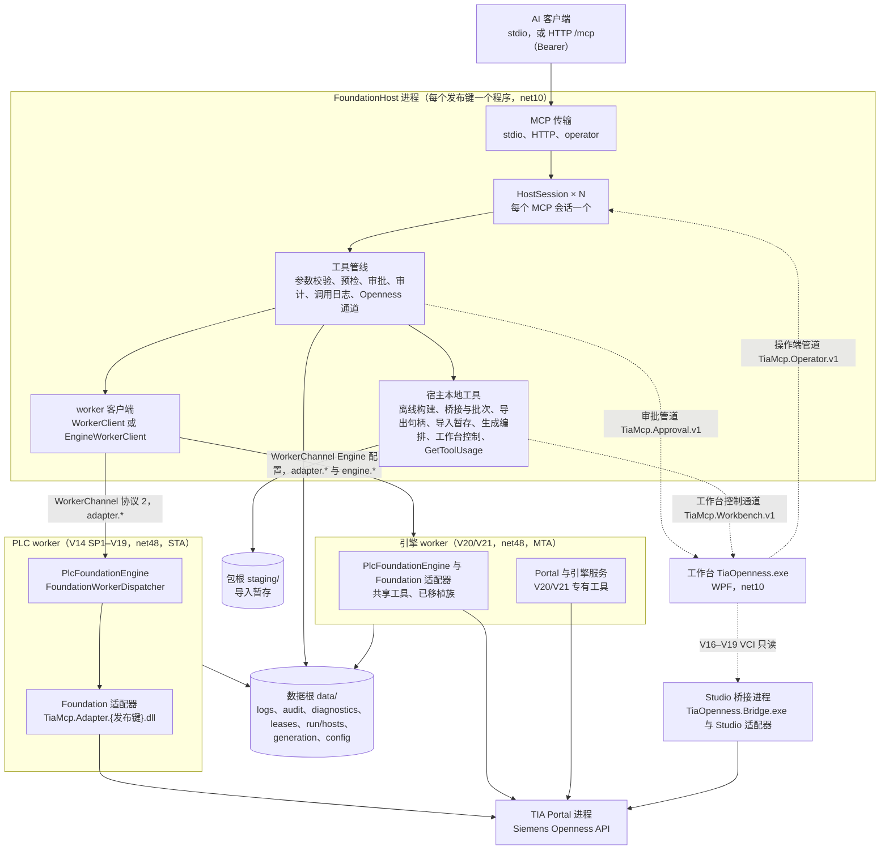
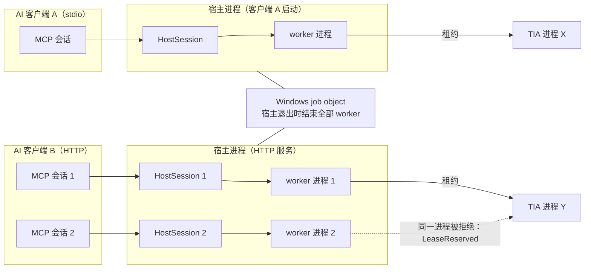
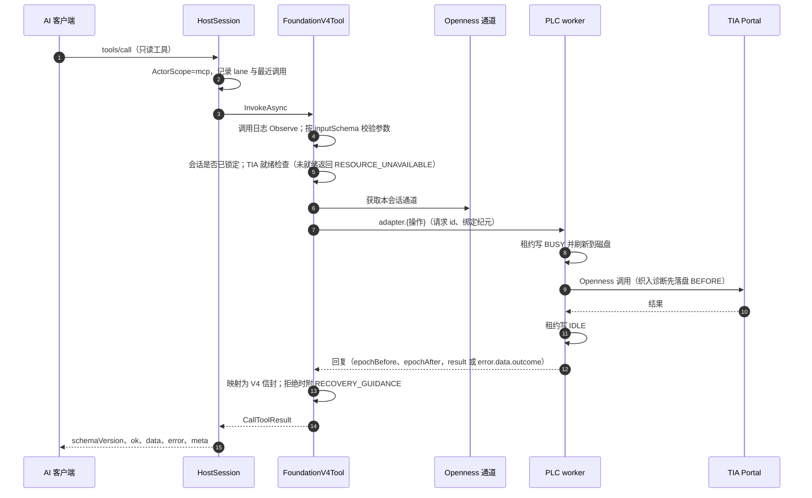
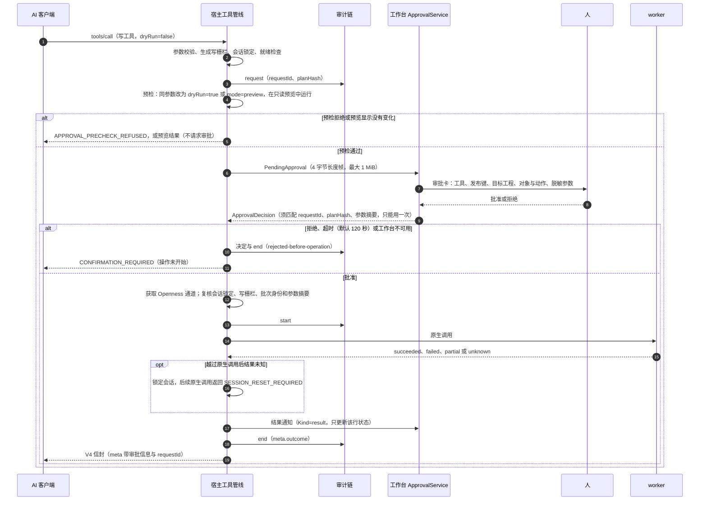
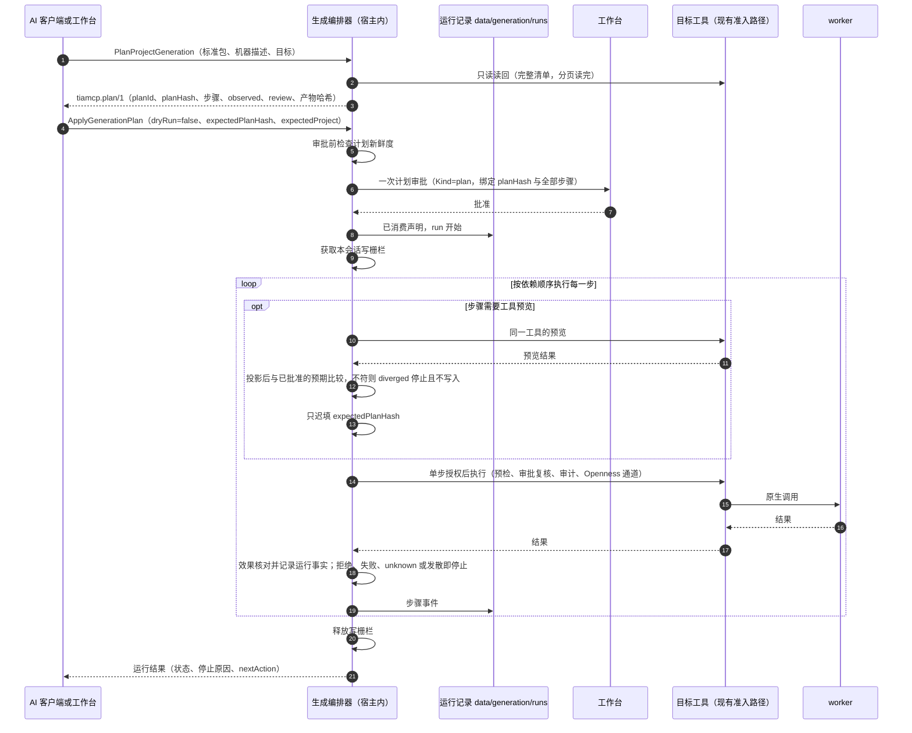
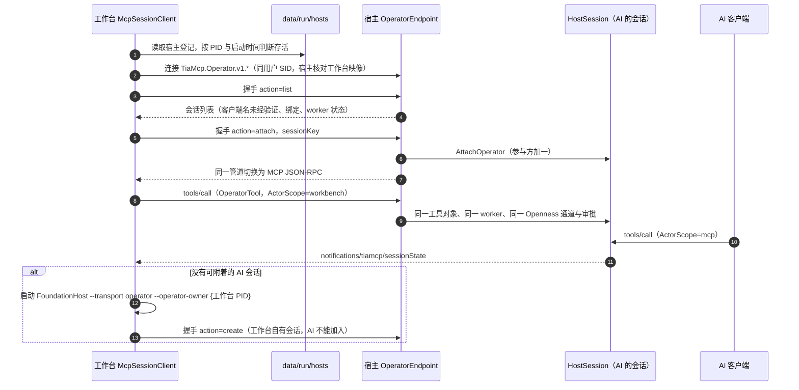
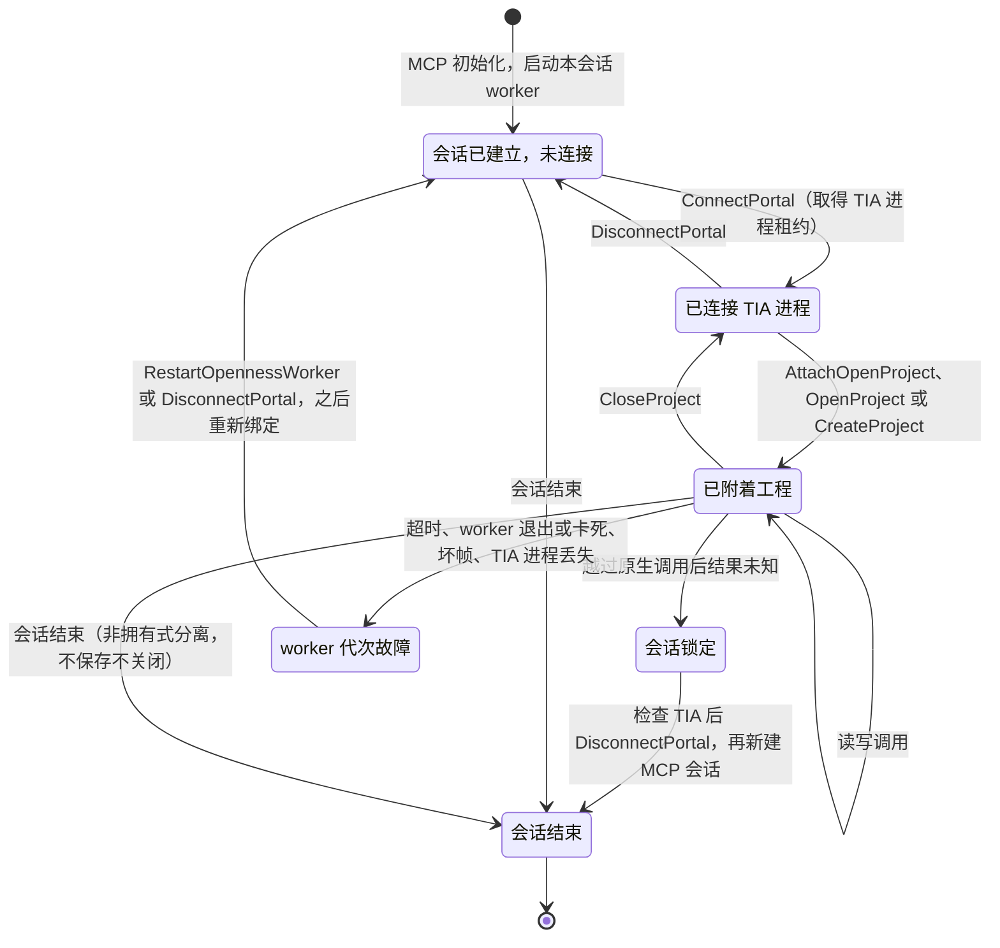
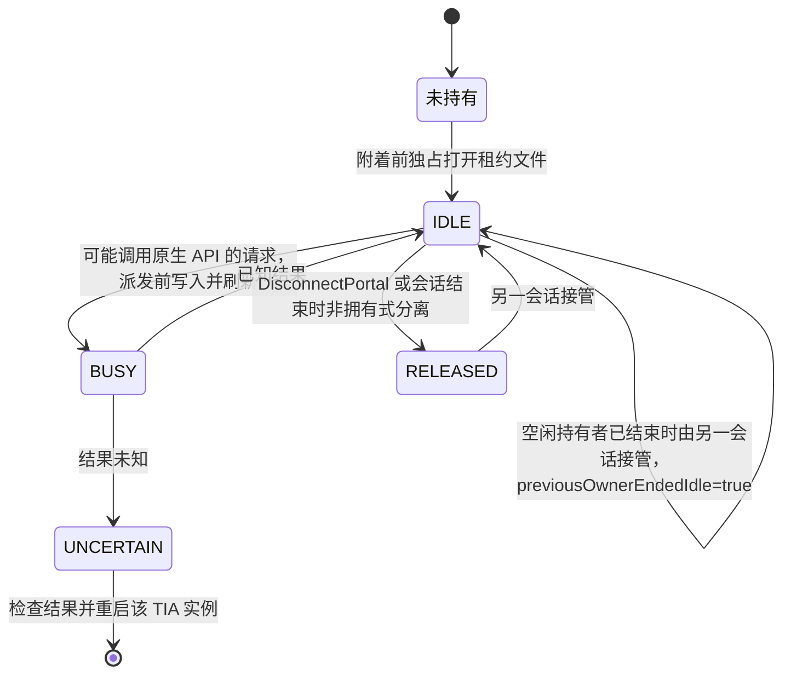

# 4.0 架构概览

状态：现行 · 最后核对：2026-10-11，master `3a227657`

[设计规范索引](README.md) · [架构决策记录](../decisions/README.md)

本页描述 4.0 源码当前的运行架构：有哪些进程、它们怎样通信、一次调用经过哪些环节，以及每个关注点在代码中的位置。所有结论都按基线提交的源码核对过；仍在进行的工作在第 9 节单列。详细设计和历史推导见第 10 节链接的文档，决策理由见 [架构决策记录](../decisions/README.md)。本页不描述单个工具的参数，参数以 `GetToolUsage` 为准。

## 1 一页概览

- 八个 TIA Portal 版本（发布键 `14sp1`、`15.1`、`16`、`17`、`18`、`19`、`20`、`21`）使用同一个 MCP 宿主程序：`runtime/v{发布键}/TiaMcp.FoundationHost.exe --release-key {发布键}`（net10，随包 .NET 10 运行时）。宿主负责 MCP 传输、工具目录、参数校验、预检、审批、审计、调用日志和 Openness 通道。
- 宿主为每个 MCP 会话启动一个 worker 进程（net48）。V14 SP1–V19 是 PLC worker `runtime/v{发布键}/worker/TiaMcp.PlcWorker.{发布键}.exe`，在 STA 所属线程上调用 Openness；V20/V21 是引擎 worker `runtime/v20|v21/worker/TiaMcp.Engine.V20|V21.exe --engine-worker`，在一个 MTA 所属线程上同时承载 Foundation 适配器和引擎代码，共用一个 TIA 连接。
- 八版共有的工具和已移植的能力族在八个版本上使用同一份 Foundation 适配器代码（`TiaMcp.Adapter.{发布键}.dll`，按发布键编译八次）。尚未移植的 V20/V21 专有工具仍由引擎代码在引擎 worker 中执行。
- 只有 worker 接触 Siemens 对象。worker 与宿主之间是 WorkerChannel 协议 2（行分隔 JSON-RPC 2.0，hello 握手核对 worker 与适配器的 SHA-256、PID 和启动 nonce，绑定纪元）。
- 每个会话一条 Openness 通道（lane），原生调用在会话内串行；不调用 TIA 的工具走并发的本地通道，不等待正在运行的 TIA 调用。
- 每个版本都用 TIA 进程租约把选定的 TIA 进程保留给一个 MCP 会话。越过原生调用后结果未知的写入会锁定会话，后续原生调用返回 `SESSION_RESET_REQUIRED`。
- MCP 写调用默认需要工作台审批（审批管道 `TiaMcp.Approval.v1.*`），审批前先用预览参数预检；请求、决定和结果写入哈希链审计。
- 工作台（`TiaOpenness.exe`，WPF/net10）通过三条同用户命名管道与宿主协作：审批管道（宿主是客户端）、工作台控制通道（宿主是客户端，八个工作台控制工具）、操作端管道（工作台是客户端，附着到已有的 MCP 会话，与 AI 用同一 worker、同一审批与审计）。
- 生成框架（标准包、机器描述、生成计划）在宿主内编排：一次计划审批，逐步经现有工具执行，逐步审计，发散即停。

## 2 组件视图

图中实线是调用方向，虚线是工作台相关的本机管道。Studio 桥接进程是迁移期的遗留路径：工程操作页的其余功能已经改走操作端管道，V16–V19 的版本控制页在 F33 移入 Foundation 适配器之前用它只读 VCI（见第 9 节）。

### 2.1 程序与目录

| 程序 | 位置 | 框架 | 作用 |
|---|---|---|---|
| 包根启动器 | `TiaOpenness.exe` | .NET Framework（csc 编译） | 打开 `runtime/studio/TiaOpenness.exe` |
| 工作台 | `runtime/studio/TiaOpenness.exe` | net10 WPF | MCP 与客户端配置、工程操作页、AI 调用、审批、审计、环境检查、版本控制、设置 |
| MCP 宿主 | `runtime/v{发布键}/TiaMcp.FoundationHost.exe` 及 `release-key.txt` | net10 | MCP 服务器入口，八个版本相同 |
| PLC worker | `runtime/v{发布键}/worker/TiaMcp.PlcWorker.{发布键}.exe` | net48 | V14 SP1–V19 的 Openness 执行进程 |
| 引擎 | `runtime/v20|v21/worker/TiaMcp.Engine.V20|V21.exe`，旁边是同一二进制生成的 `tool-catalog.json` | net48 | V20/V21 的 worker（`--engine-worker`）、目录导出（`--write-tool-catalog`）和 CLI（`gen`、`patch`、`compile`、`audit verify` 等）；无参数时打印用法并以 64 退出 |
| Studio 桥接 | `runtime/studio/bridge/` 与 `bridge/adapters/v{发布键}/` | net48 | 迁移期遗留，见第 9 节 |
| 更新器 | `runtime/tools/TiaMcp.Updater.exe` | net48 | 交付包更新与回滚 |
| 写入防护钩子 | `runtime/tools/TiaMcp.WriteGuard.exe` | net10 | Claude Code 插件的写操作审计钩子 |

net10 与 net48 的依赖必须分目录，所以 V20/V21 的引擎放在 `worker/` 子目录。宿主启动时从 `release-key.txt` 核对发布键，从 `BundleLayout` 定位 worker，V20/V21 还核对 worker 文件哈希与目录中记录的哈希一致。

## 3 进程与会话视图

- stdio：客户端启动一个宿主进程，进程内一个会话、一个 worker。HTTP：一个宿主进程服务多个同时存活的会话，每个会话一个 worker，不设会话数上限，部署时按 worker 内存和 TIA 实例数控制并发。`/mcp/health` 不鉴权（含 `fileVersion`），`/mcp/ready` 与 MCP 调用使用同一 Bearer 密钥。V20/V21 的 HTTP 宿主在监听前用一个临时探测会话核对版本与能力，探测会话不服务客户端。
- 每个 worker 都绑定宿主的 job object（`WorkerJob`）：宿主退出或被终止时 worker 随之结束；worker 自己启动的 TIA 进程脱离 job，继续运行。
- 会话结束、stdio EOF、Ctrl+C、控制台关闭和 HTTP 宿主停止都会关闭 worker 通道，空闲 worker 最多等待 10 秒做非拥有式分离并把租约写为 `RELEASED`，不保存也不关闭工程；仍有请求在进行或超时才结束 worker。
- 断开、故障、重启、暂存批次和导出句柄都按会话隔离；导出内容的进程内容量上限（32 个句柄、8,000,000 字符）是全进程共用的。
- 宿主在 `<数据根>/run/hosts/<PID>-<启动 ticks>.json` 原子写入登记记录（发布键、传输、操作端管道名、会话快照），退出时删除，供工作台发现。

## 4 宿主内部结构

两条宿主路径共用同一套宿主层代码（`src/EngineHost` 链接引擎的宿主层源码，以 `TIA_ENGINE_HOST` 编译为 net10），差别在工具从哪里来、发往哪个 worker。

| 方面 | V14 SP1–V19 | V20/V21 |
|---|---|---|
| 入口 | `Program.cs` → `HostSession.Legacy` | `Program.cs` 发现 `WorkerKind == "engine"` → `EngineReleaseHost.Run` |
| 工具来源 | `LegacyHostToolRegistry`：Foundation 工具、已移植族契约、离线构建、工作台控制、生成、被动诊断、`GetToolUsage`；再由 `FoundationHostPorts` 包入 `EngineHostPipeline`，提供桥接、批次与导出句柄 | `EngineCatalog` 读取 `worker/tool-catalog.json`（引擎 `--write-tool-catalog` 生成），`SharedToolCatalog` 合入共享 Foundation 工具；`EngineHostPipeline` 发布 full 或 lite 目录 |
| 单个工具的准入 | `FoundationV4Tool`（参数校验、生成写栅栏、未提供能力拒绝、会话重置、就绪检查、预检、审批、Openness 通道、复核、审计） | Foundation 工具同左；引擎工具走链接进来的引擎宿主层（`McpServer.SerializedCalls` 等，顺序见第 5.2 节）；已移植族由 `PortedToolContract.Wrap` 包装 |
| 执行位置 | 宿主本地，或经 `WorkerClient` 发 `adapter.<操作>` 到 PLC worker | 由 `ToolExecution` 表决定：`host`（宿主本地）、`foundation`（`adapter.*` 到引擎 worker 内的 `PlcFoundationEngine`）、`worker`（`engine.invoke` 到引擎代码） |
| worker 调用超时 | 共享 `WorkerTimeoutPolicy`（P8-64），预算与配置见 [4.0 发布说明](../../releases/v4.0.0.md) | `WorkerTimeoutPolicy`：默认 120 秒，worker 代次的首次附着 300 秒，编译、下载上传、导入导出、归档和库更新 30 分钟；可用 `--worker-timeout-config` 或 `TIA_MCP_WORKER_TIMEOUTS` 覆盖 |
| 线程 | STA 所属线程 | 一个 MTA 所属线程，Foundation 代码与引擎代码共用同一个 TIA 连接 |
| 审批与审计的宿主标记 | `foundation` | 引擎工具 `engine`，共享 Foundation 工具 `foundation` |

### 4.1 版本差异的处理

- 发布键决定工具目录。旧版只注册至少有一个已实现动作能在该版 API 上运行的已移植工具；部分动作缺 API 的工具保留，并在原生调用前对该动作返回 `UNSUPPORTED_CAPABILITY`。依据是 `src/Adapters.Contracts/PortedFamilies.cs` 的逐工具、逐发布键表，注册、发现、用法、桥接和被动诊断共用它。
- 编译期差异由 `src/Shared/TiaFeatures.props` 的特性符号表达（例如过程映像服务只在 V21），适配器按精确 PublicAPI 编译八次；运行期不靠工具名或相邻版本推断能力。
- V20/V21 的版本准入（`ToolVersionPolicy`）在发现、桥接、预检和派发前生效；V20 的排除工具由目录和官方 API 支持规则生成。
- 原生行为能力按 D1 行为族披露，当前八版全部为 `current / NOT RUN`；SafeV4 候选实现只在显式 `TiaMcpTestPolicy` 测试构建中可选。

## 5 关键流程

### 5.1 只读调用

以 V19 的一次只读工具调用为例（V20/V21 的共享 Foundation 工具相同，只是 worker 换成引擎 worker 内的 `PlcFoundationEngine`）。

V20/V21 专有工具的区别：宿主侧由引擎宿主层处理（调用日志、版本准入、就绪守卫、Openness 通道、响应保护），`WorkerToolInvoker` 通过 `EngineWorkerClient` 发送 `engine.invoke`；引擎 worker 的 `EngineWorkerHost` 在 MTA 所属线程上绑定 V4 参数并调用引擎服务，回复携带原样结果、`nativeCallIssued`、绑定快照、会话状态和原生故障标记。超过 1 MiB 的请求在派发前拒绝；过大的回复转存为导出句柄（`WorkerReplySpill`）；进度通知转发到调用方的 progress token。

### 5.2 写调用与审批

- 审批范围：目录分类为 `WRITE`、`ONLINE-WRITE` 的实际执行，以及 `SaveProject`、`SaveProjectCopy`、`CloseProject`、`StageImportFiles`、`CleanupStagedImportFiles`；连接、附着、打开和断开不审批。预览（`dryRun: true`、`mode: preview`）不审批，也不作为写请求写入审计。
- 关闭审批时照常执行并在 `meta` 中披露 `APPROVAL_DISABLED`；工具自身的确认、计划哈希和工程身份检查不受影响。
- 审批管道名绑定当前 Windows 用户 SID 与 `approval.settings` 的绝对路径，受保护 DACL 只允许当前用户，拒绝远程客户端，双方互相核对 SID。威胁模型是“AI 经 MCP 工具越权写入”，不防同一用户下的恶意本机进程（见第 8 节）。
- 引擎工具的顺序相同：调用日志 → 审批前预检（在自己的通道中预览）→ 等待审批 → 获取 Openness 通道 → 会话锁定检查 → 审批复核 → 运行时绑定校验 → 审计 start → 调用方输入文件校验 → 执行 → 披露目标 → 会话结果观察 → 完成审批。

### 5.3 生成运行

- 编排器在宿主内（`src/Shared/Host/GenerationExecutionTools.cs`，旧版经 `src/FoundationHost/GenerationTool.cs` 注册），八个版本相同；步骤是否可用取决于该版目录。
- 运行期间同一会话中其他写调用（包括附着的工作台面板）被写栅栏拒绝；取消只在步骤之间生效；批准后的运行不再按 10 分钟计划期限中断，另有 4 小时和 10,000 步上限。
- 新建工程模式：`CreateProject` 步骤之后核对同一进程、路径与预测一致、绑定纪元前进、读回为空工程，全部通过才在同一运行中换绑（transition）。
- 运行记录是只追加的 `tiamcp.run/1`，宿主重启后仍可由 `GetGenerationRun` 读取；中断的步骤记为 unknown，从不重放。
- 尚未实现：生成记录文件 `.tiagen.json` 与 `PublishGenerationRecord`（P8-31e5）、SafeV4 候选规则（e6）、工作台计划视图扩展（h1）。

### 5.4 工作台附着会话

- “人”或“AI”由传输决定（`ActorScope`），不读取任何参数；审计行、调用日志和审批请求都带 `actor`。面板发起的写同样要在审批卡上批准。
- 会话规则对所有参与方相同：Openness 通道串行、结果未知锁定、`DisconnectPortal` 与 `RestartOpennessWorker` 影响整个会话。
- 工作台控制工具（`ShowWorkbenchPage` 等八个）走工作台控制通道：宿主以 250 毫秒连接超时连到工作台，发送前核对服务端 SID 和同包工作台映像；读取类 2 秒、界面类 5 秒截止；不进 worker、Openness 通道、审批或审计链，只写调用日志；工具从不启动工作台；“允许 AI 控制界面”只能由人在设置中更改。

## 6 生命周期

### 6.1 MCP 会话与工程绑定

- 没有连接 TIA 时，需要 TIA 的 Foundation 工具在派发前返回带 `ConnectPortal` 提示的 `PRECONDITION_FAILED`，会话保持可用。
- 锁定后的恢复对八个版本相同：先检查 TIA，再调用 `DisconnectPortal`。空闲 worker 干净分离（V20/V21 同时释放租约）；忙碌、超时或丢失的 worker 被结束，回复说明需要重启 TIA。然后新建 MCP 会话并重新绑定，不重放失败的请求。
- `RestartOpennessWorker` 先让空闲 worker 干净分离再启动新代次；故障 worker 保留租约并报告 `requiresTiaRestart`。

### 6.2 TIA 进程租约

租约文件为 `<数据根>/leases/<PID>-<进程启动 UTC ticks>.lease`，独占句柄覆盖整个连接期。另一个存活会话持有时返回 `LeaseReserved`；`BUSY`、`UNCERTAIN` 和 3.x 遗留的 `ACTIVE` 返回 `LeaseNotReleased`，不得删除租约文件绕过。V14 SP1–V19 由 PLC worker 在 STA 线程上取租约（`FoundationProcessLease`），V20/V21 由引擎 worker 取租约（`EngineWorkerHost`），共用 `src/Logic/Siemens/PortalProcessLease.cs`。

### 6.3 worker 与通道

- PLC worker 由宿主在首次需要时启动（`--native-session {发布键} {PublicAPI 目录} {nonce}`）；引擎 worker 在会话创建时启动并读取状态。
- 通道一次只有一个在途请求，id 严格递增；请求上限 1 MiB，回复行上限 16 MiB。分派前取消返回 `CANCELLED` 且不消耗 id；分派后的超时、取消、写读错误一律视为结果未知，通道失效，不重试、不自动重启。
- 绑定纪元由 worker 在每次分派前后从托管缓存读取（PID、工程路径、所有权）；宿主按操作预期核对纪元变化，异常变化使会话失效。

## 7 关注点在代码中的位置

| 关注点 | 主要位置 |
|---|---|
| 宿主入口、选项与传输 | `src/FoundationHost/Program.cs`、`HostOptions.cs`、`EngineReleaseHost.cs` |
| 每会话对象、人/AI 归属、会话快照 | `src/FoundationHost/HostSession.cs`、`HostSessionCall.cs`、`src/Shared/ActorScope.cs` |
| 旧版工具注册与被动诊断 | `src/FoundationHost/FoundationPassiveDiagnostics.cs`（`LegacyHostToolRegistry`）、`FoundationTools.cs`、`*Contract.cs`、`FoundationHostPorts.cs` |
| Foundation 工具准入、预检、审批与结果映射 | `src/FoundationHost/FoundationV4Tool.cs`、`FoundationV4Result.cs`、`src/Logic/V4/HostBehavior.cs`、`src/Shared/SessionBehavior.cs` |
| V20/V21 宿主管线 | `src/EngineHost/EngineHostPipeline.cs`、`EngineCatalog.cs`、`SharedToolCatalog.cs`、`WorkerToolInvoker.cs`；链接的 `src/Engine/ModelContextProtocol/Tools/McpServer.{Approval,SerializedCalls,VersionPolicy,ArgDiagnostics,Profile,CallDiscipline}.cs` 与 `src/Shared/Host/McpServer.{ToolBridge,Batch,Exports}.cs` |
| Openness 通道 | `src/Shared/Host/ToolDispatchLanes.cs` |
| worker 客户端、job object、关停 | `src/FoundationHost/WorkerClient.cs`、`EngineWorkerClient.cs`、`WorkerJob.cs` |
| worker 通道协议、超时、回复转存、故障注入 | `src/WorkerChannel/` |
| PLC worker | `src/PlcWorker/Program.cs`、`FoundationWorkerDispatcher.cs`、`WorkerOperations.cs`、`WorkerOperationModule.cs`、`FoundationProcessLease.cs` |
| 引擎 worker 与目录导出 | `src/Engine/Program.cs`、`src/Engine/WorkerMode/EngineWorkerHost.cs`、`SharedSessionLifecycle.cs`、`src/Engine/Cli/ToolCatalogExport.cs` |
| V20/V21 专有工具实现 | `src/Engine/ModelContextProtocol/Tools/*Tools.cs`、`src/Engine/Siemens/Services/`、`src/Engine/Siemens/Portal/` |
| 已移植族的声明与宿主契约 | `src/Shared/*Tools.cs`、`src/Shared/*PortService.cs`、`PortedToolDeclarations.cs`、`DeclaredToolMetadata.cs`、`src/FoundationHost/PortedToolContract.cs` |
| 族与发布键的注册表 | `src/Adapters.Contracts/PortedFamilies.cs` |
| Foundation 适配器 | `src/Adapters/Native/{Session,Plc,Hardware,Libraries,Engineering,Reflection,Vci}`、`src/Adapters/Policy`、`src/Adapters/V*/`、`src/Adapters/build/Adapter.Sources.props`、`src/Shared/shared-native/` |
| 适配器契约 DTO | `src/Adapters.Contracts/` |
| 版本目录与编译特性 | `src/Logic/Siemens/TiaVersionCatalog.cs`、`src/Shared/TiaFeatures.props`、`src/Shared/TiaPublicApi.props` |
| TIA 进程租约 | `src/Logic/Siemens/PortalProcessLease.cs` |
| V4 信封、错误、计划、候选 | `src/Logic/V4/` |
| 工具目录、分类、执行位置、lite 档 | `src/Logic/ModelContextProtocol/ToolExecution.cs`、`ToolTaxonomy`、`ToolMetadata`、`ToolProfiles.resx`；`src/Shared/ToolUsageCatalog.cs` 与 `ToolUsageData.json`（由 `reference/tool-examples` 生成） |
| 安装布局与数据目录 | `src/Shared/BundleLayout.cs`、`src/Shared/DataLocations.cs` |
| 审批管道 | `src/Shared/ApprovalPipe.cs`、`ApprovalProtocol.cs`、`ApprovalSettings.cs`、`ApprovalResult.cs`；工作台 `src/Studio/Gui/Services/ApprovalService.cs` |
| 审计链 | `src/Shared/AuditLog.cs`、`AuditInvocation.cs`、`AuditCli.cs`（引擎 CLI `audit verify`）；工作台 `AuditLogService.cs`、`AuditTailReader.cs` |
| 调用日志与原生诊断 | `src/Shared/InvocationJournal.cs`、`NativeCallDiagnostics*.cs`、`build-tools/native-call-weaver` |
| 工作台控制通道 | `src/Shared/WorkbenchControl{Pipe,Protocol,Frames}.cs`、`LocalPipeSecurity.cs`；`src/FoundationHost/WorkbenchControl{Client,Session,Tools}.cs`；`src/Studio/Gui/Control/` |
| 操作端 | `src/Shared/OperatorPipe.cs`、`OperatorProtocol.cs`；`src/FoundationHost/OperatorEndpoint.cs`、`OperatorConnection.cs`、`HostRegistration.cs`、`SessionNotifications.cs`；工作台 `McpSessionClient.cs`、`McpProjectClient.cs`、`McpVersionControlClient.cs` |
| 生成框架 | `src/Logic/Generation/`、`src/Shared/Host/GenerationTools.cs`、`GenerationExecutionTools.cs`、`src/FoundationHost/GenerationTool.cs`、`schemas/standards/v1/`、`templates/standards/` |
| 导入暂存 | `src/Logic/ModelContextProtocol/ImportStagingStore.cs`、`ImportStagingSession.cs` |
| 工作台界面与启动器 | `src/Studio/Gui/`、`src/Studio/Launcher/Launcher.cs` |
| 迁移期遗留的 Studio 会话栈 | `src/Studio/Bridge`、`Client`、`Core`、`Openness/V*`、`src/Adapters/Native/Studio`；`src/Studio/Gui/Services/ReadOnlyVciBridge.cs` |
| 运行时通道（S7、OPC UA、Web API、Open Pipe） | `src/OnlineChannels/` |
| 更新器、写入防护 | `src/Updater/`、`src/Tools/WriteGuard/`、`hooks/hooks.json` |
| 构建、发布、检查 | `build-tools/release/`、`tests/test-suites.json` |

## 8 数据、文件与信任边界

| 位置 | 内容 | 写入者 |
|---|---|---|
| `<数据根>/logs/<发布键>/` | 宿主主日志（每进程一个文件，保留最新 32 份） | 宿主 |
| `<数据根>/logs/studio/` | 工作台崩溃日志 | 工作台 |
| `<数据根>/logs/audit/` | 审批与写调用的哈希链（`audit-<序号>.jsonl`，10 MiB 轮转，不自动删除） | 宿主、工作台（开关变化） |
| `<数据根>/diagnostics/` | 调用日志 `calls-*.jsonl` 与原生调用诊断（先落盘再执行原生调用） | 宿主、worker |
| `<数据根>/leases/` | TIA 进程租约 | worker |
| `<数据根>/run/hosts/` | 宿主登记 | 宿主 |
| `<数据根>/generation/` | 生成计划产物、运行记录、已消费声明 | 宿主 |
| `<数据根>/config/` | `approval.settings`、`journal-retention.settings`、客户端与 HTTP 配置 | 工作台 |
| `<数据根>/worker-spills/` | 过大回复的临时转存 | 宿主 |
| `<包根>/staging/<会话>/<批次>/` | 导入暂存文件与批次清单 | 宿主 |

数据根优先用 `TIA_MCP_DATA_DIRECTORY`，其次是可写的 `<包根>/data`，都不可用时按用途回退到用户目录（详见 [运行时布局](../runtime-layout.md)）。

信任边界是“同一 Windows 用户”。三条管道都使用受保护 DACL、拒绝远程客户端并核对对方 SID，工作台控制通道与操作端管道还核对同包工作台映像。它们防止 MCP 客户端经工具参数、元数据或批次越权（例如自批写操作、关闭审批），不防同一用户下能执行代码的本机进程。`SaveExportContent` 不能写 `approval.settings`。审计哈希链只能发现保留记录的篡改、缺失和插入，不能证明日志完整。

## 9 当前过渡状态与已知缺口

| 项目 | 状态 | 依据 |
|---|---|---|
| V20/V21 专有工具移入 Foundation 适配器 | B1–B6 与样板 F19 已合并（F01、F02、F03、F06、F08–F21、F23、F35）；B7–B12（Classic 与 Unified HMI、生命周期与安全、VCI、在线与下载、可选产品）仍在引擎中 | `PortedFamilies.cs`；[阶段 8 迁移方案](../phase8-port-plan.md) |
| 引擎退役（P8-04） | 未开始；全部族移植后 V20/V21 改用 PLC worker | [重构计划](../refactor-plan.md)；[ADR 0009](../decisions/0009-port-v20-v21-tools-to-foundation-adapters.md) |
| Studio 桥接与 Studio 适配器删除（P8-21f） | 未开始；V16–V19 版本控制页用桥接只读 VCI，禁用工作区到工程的同步 | `ReadOnlyVciBridge.cs`；工作台控制设计决定 4 |
| 工作台控制端到端验收（P8-20e） | 未完成 | 工作台控制设计第 6 节 |
| 生成记录与发布工具（P8-31e5）、SafeV4 规则（e6）、审批抽屉计划视图（h1） | 未实现 | [分阶段生成设计](../design/p8-31-staged-generation.md) 第 10 节 |
| 真机验收 | 八版 D1 行为族、旧版启用的已移植族、V20/V21 在 Foundation 宿主上的验收（P7-07）均为 `NOT RUN`，集中在阶段 8 结束后一次进行 | 交接、真机台账；[ADR 0013](../decisions/0013-release-4-0-after-phases-7-and-8.md) |
| `TiaSharedAdapterPaths` | 默认 `false`；引擎领域的共享原语路径在真机验收前不启用 | `src/Shared/TiaSharedAdapterPaths.props` |
| PLC worker 调用超时 | P8-64 已消除：八版共用按类超时与配置覆盖；超预算仍为结果未知并锁定会话。预算见 [4.0 发布说明](../../releases/v4.0.0.md) | `src/FoundationHost/WorkerClient.cs`；[设计规范决定](README.md#决定摘要) |
| Foundation 绑定快照生命周期 | 观测原语已有，worker 生命周期尚未接入；旧版附着仍只凭 PID | [版本框架](../unified-version-framework.md) |

## 10 详细设计文档

| 主题 | 文档 | 说明 |
|---|---|---|
| 当前交接与计划 | [handoff.md](../handoff.md)、[refactor-plan.md](../refactor-plan.md)、[roadmap.md](../roadmap.md) | 任务启动基线的事实与状态已刷新；以重构计划为任务状态入口 |
| 阶段 7：V20/V21 改用 Foundation 宿主 | [阶段 7 宿主与 worker 拆分设计](../design/p7-host-worker-split.md) | 历史记录（已实施）；决定见 ADR 0005–0008 |
| 阶段 8 迁移方案 | [phase8-port-plan.md](../phase8-port-plan.md) | 族、批次、闸门 |
| 工作台控制与共享会话 | [phase8-workbench-control.md](../design/workbench-control-and-shared-session.md) | 现行设计；§1 的现状描述早于 P8-21 |
| 生成框架 | [phase8-generation-framework.md](../design/project-generation-framework.md)、[分阶段生成执行设计](../design/p8-31-staged-generation.md) | 前者 §6.3 已被 D3 决定修改，以后者为准 |
| 运行时布局、审批、控制通道、租约、审计 | [runtime-layout.md](../runtime-layout.md) | 现行，个别数字过期 |
| 版本框架 | [unified-version-framework.md](../unified-version-framework.md) | 运行形态一节过期 |
| 适配器与 worker 协议 | [adapter-merge.md](../adapter-merge.md) | 协议 2 的定义仍有效；其余为阶段 4 历史 |
| 引擎拆分 | [engine-decomposition.md](../engine-decomposition.md) | 阶段 3 历史 |
| V4 契约 | [phase6-review.md](../phase6-review.md) | 已冻结；现行协议见 [V4 工具协议规范](v4-protocol.md) |
| 验证与发布 | [validation.md](../validation.md)、[release-workflow.md](../release-workflow.md) | 现行，个别命令过期 |
| 设计决策 | [架构决策记录](../decisions/README.md) | 一页一个决定，含待补写清单 |

## 版本处理与通道规范

八个发布键由 `TiaVersionCatalog` 统一解释，不把原版 V14、V15 视为 SP1 或 V15.1 的别名。FoundationHost 校验所选发布键、worker 和 PublicAPI，编译特性与文档格式边界见[版本框架](../unified-version-framework.md)。已移植工具只有至少一个已实现动作能在该版官方 API 上执行时才注册，见 [ADR 0012](../decisions/0012-old-release-tool-registration.md)；具体工具和数量由目录生成，不由架构正文手写。

内部帧与绑定纪元的现行定义见[worker 协议 2](worker-protocol.md)。历史适配器设计的协议对比表描述迁移过程，不再作为当前运行形态表。
